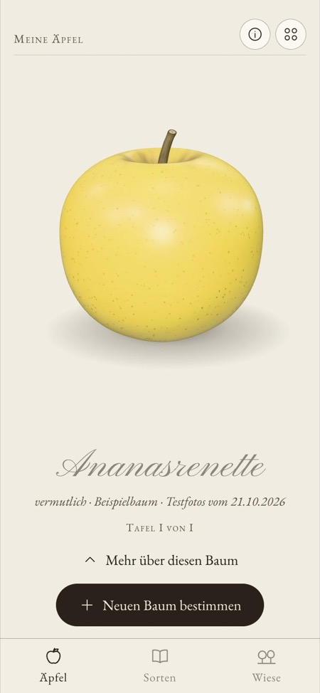
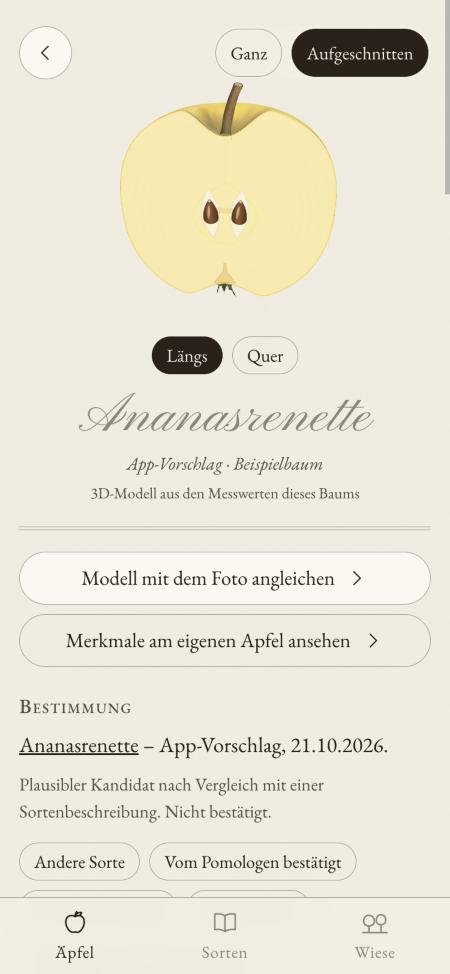
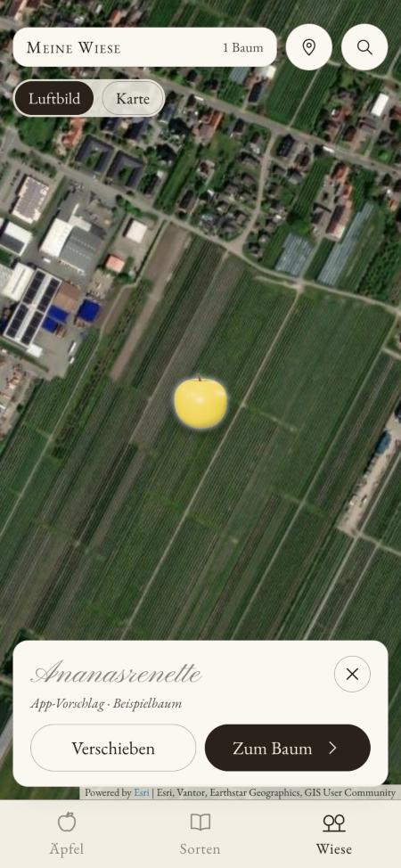
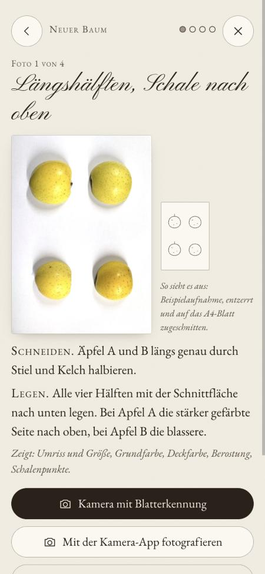
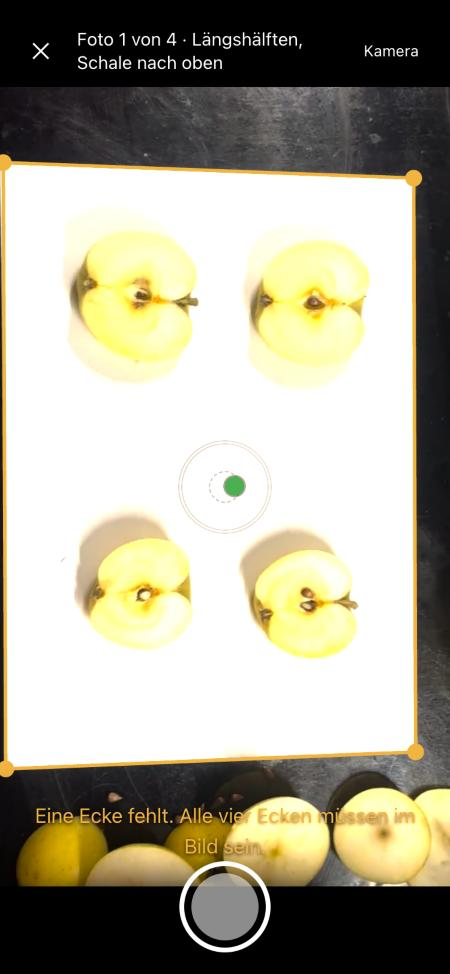
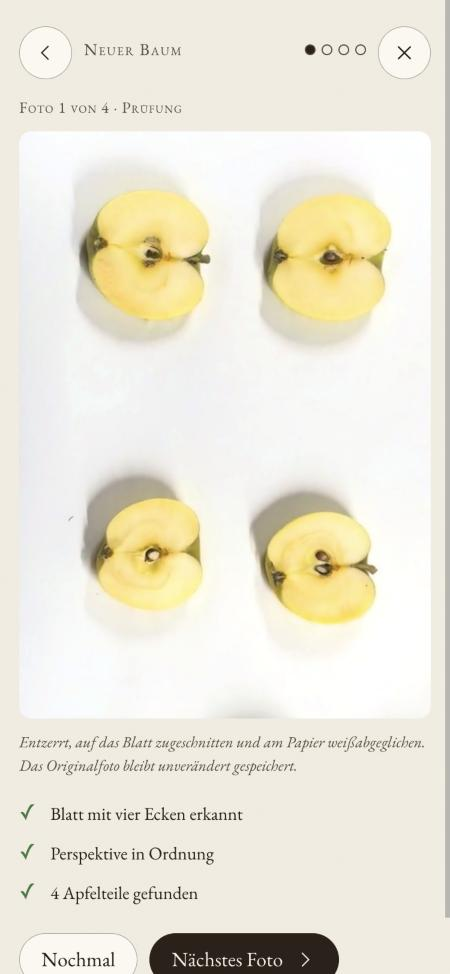
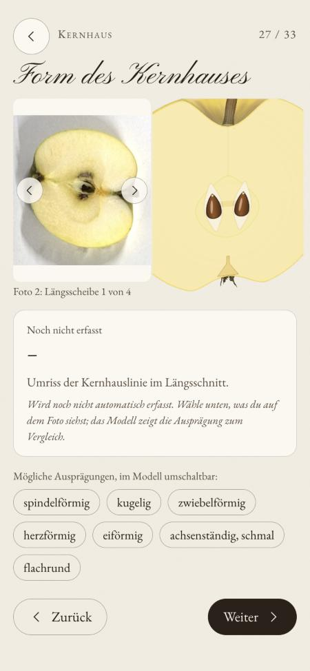
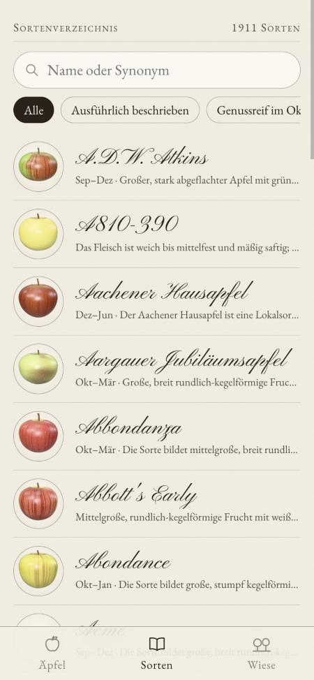
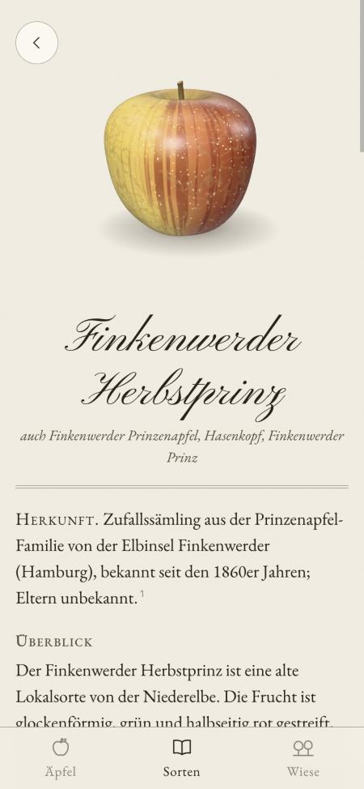

# Apfelwiese

**Alte Apfelsorten bestimmen und dokumentieren – mit vier Fotos, einem A4-Blatt und einem Messer.**

Die Apfelwiese ist eine Web-App fürs Smartphone. Du schneidest vier typische Äpfel eines Baums auf und fotografierst sie auf einem weißen Blatt Papier. Die App misst daraus Größe, Form und Farben, baut ein 3D-Modell deines Apfels und vergleicht ihn mit über 1.900 beschriebenen Sorten. Deine Bäume sammelst du auf einer Luftbildkarte: deiner Wiese.

**Ausprobieren:** [apfelwiese.app](https://apfelwiese.app) (am besten auf dem Handy öffnen und zum Home-Bildschirm hinzufügen)

<p align="center">
  
  
  
</p>

> **Stand:** Prototyp, Oktober 2026. Die Sortenvorschläge sind Hinweise, keine Bestimmung. Sicher wird eine Sorte erst durch eine Pomologin, einen Pomologen oder eine DNA-Analyse.

---

## Was die App macht

### 1. Vier Äpfel, vier Fotos

Für jeden Baum nimmst du vier typische Äpfel und schneidest sie unterschiedlich auf: längs, quer, in Scheiben. Jedes der vier Fotos zeigt andere Merkmale, etwa Schale und Umriss, Kernhaus, Kelch und Stiel oder den Kernhausstern. Vor jedem Foto zeigt die App eine Beispielaufnahme, wie es aussehen soll.

Die Kamera erkennt das A4-Blatt live, auch bei farbigem Kunstlicht. Sie zeigt mit einer Wasserwaage, ob das Handy gerade gehalten ist, und löst selbst aus, sobald alles passt. Danach wird das Foto entzerrt, auf das Blatt zugeschnitten und am Papier weißabgeglichen. Das Blatt ist dabei Maßstab und Farbreferenz zugleich.

<p align="center">
  
  
  
</p>

### 2. Dein Apfel in 3D

Aus den Messwerten entsteht ein 3D-Modell deines Apfels. Es hat die gemessene Größe, Form und Grund- und Deckfarbe, dazu Schalenpunkte, Glanz, Stiel und Kelch. Du kannst es drehen. Auf dem Handy folgt es der Neigung, und es lässt sich längs und quer aufschneiden, mit Kernhaus, Kernfächern und Kernen. Wo die Messung danebenliegt, gleichst du das Modell von Hand an: mit einer Farbpipette direkt auf deinem Foto und mit Reglern, das Foto daneben zum Vergleich.

### 3. Merkmal für Merkmal am eigenen Apfel

Ein Rundgang führt durch die Merkmale, die Pomologen zur Bestimmung nutzen: Fruchtform, Deckfarbe, Schalenpunkte, Stiel und Stielgrube, Kelch und Kelchgrube, Form des Kernhauses, Kernfächer, Kerne, Fleisch, Geschmack, Geruch und Reifezeit.

Zu jedem Merkmal zeigt die App den passenden Ausschnitt deines Fotos neben dem 3D-Modell, das an dieselbe Stelle heranzoomt. Darunter stehen die möglichen Ausprägungen. Du tippst an, was du siehst, das Modell zeigt es sofort, und deine Angabe wird gespeichert.

### 4. Ein Vorschlag aus über 1.900 Sorten

Messwerte und Angaben vergleicht die App Merkmal für Merkmal mit allen Sorten der Datenbank. Heraus kommt eine Rangliste mit Begründung: welche Merkmale passen und welche nicht. Bestimmt jemand mit Fachwissen den Baum, hältst du das mit der passenden Vertrauensstufe fest (App-Vorschlag, eigene Bestimmung, Pomologe, DNA).

<p align="center">
  
  
  
</p>

### 5. Sorten entdecken

Das Sortenverzeichnis zeigt jede Sorte als 3D-Apfel, errechnet aus ihren beschriebenen Merkmalen. Ein Porträt enthält Herkunft, Beschreibung, Genussreife, Merkmale, Abbildungen aus alten Pomologien und eine Quellenangabe zu jedem einzelnen Wert. Das Verzeichnis kann man ohne Konto durchsuchen.

### 6. Deine Wiese

Unter „Wiese“ stehen deine Bäume als ihre Äpfel auf einem Luftbild. Beim ersten Öffnen suchst du den Ort deiner Wiese, danach öffnet die Karte immer dort. Bäume setzt du an die richtige Stelle, und verschoben werden sie nur nach einem Tipp auf „Verschieben“, damit nichts aus Versehen verrutscht.

### Konto und Daten

Für eigene Bäume meldest du dich mit deiner E-Mail-Adresse an, ohne Passwort: Du bekommst einen sechsstelligen Code. Bäume und Fotos liegen dann in einem privaten Speicher in Frankfurt am Main und auf deinem Gerät, sichtbar nur für dich. Fotos zur Verbesserung der App zu nutzen, ist eine eigene, freiwillige Einwilligung. Konto und Daten kannst du jederzeit selbst löschen. Es gibt keine Werbung und keine Statistikdienste.

---

## Wie es im Hintergrund funktioniert

### Grundsätze

- **Messen per Code.** Größen, Farben und Formen misst Bildverarbeitung, kein Sprachmodell. Das macht Ergebnisse nachvollziehbar und wiederholbar.
- **Ein Merkmalskatalog für alles.** Merkmale und Ausprägungen sind einmal zentral definiert ([`merkmalskatalog.ts`](app/src/daten/merkmalskatalog.ts)), angelehnt an das NAP-Deskriptorenhandbuch. Erfassung, Abgleich, Rundgang, Erklärtexte und 3D-Modell lesen daraus.
- **Jeder Wert hat eine Quelle.** In der Sortendatenbank trägt jede Angabe Werk oder Datensatz, Seite und Lizenz.
- **Vorschläge der App werden nie zur Referenz.** In die Sortendaten gehen nur bestätigte Bestimmungen ein, sonst würde die App ihre eigenen Fehler verstärken.

### Bildverarbeitung ([`app/src/kamera/`](app/src/kamera))

1. **Blatt finden.** Die App schätzt die Farbe des Papiers im aktuellen Licht. Von dort wächst eine Region über alles, was papierähnlich ist; weiche Schatten werden mitgenommen, an harten Kanten ist Schluss. An den Rand passt sie vier Geraden (RANSAC) und berechnet daraus die Ecken. Das läuft in einem Web Worker, mehrmals pro Sekunde.
2. **Entzerren.** Eine Homographie bildet das Blatt auf ein Rechteck mit festem Maßstab ab (Millimeter pro Pixel).
3. **Weißabgleich** am Papier, örtlich in einem Raster aus 3-cm-Feldern, damit ungleichmäßiges Licht ausgeglichen wird.
4. **Freistellen.** Äpfel und Scheiben heben sich über ihren Farbabstand zum Papier ab, Schatten bleiben draußen. Lücken werden geschlossen, Löcher gefüllt.
5. **Messen.** Breite, Höhe und Verhältnis an den Hälften. Grund- und Deckfarbe werden pixelweise im Lab-Farbraum getrennt. Schalenpunkte mit Hof werden gezählt, Kerne ebenfalls, dazu Fleischfarbe und die Lage jedes Apfelstücks für die Ausschnitte im Rundgang.

### 3D-Modell ([`app/src/apfel3d/`](app/src/apfel3d))

- **Form:** ein Rotationskörper aus einem Superellipsen-Profil mit Stiel- und Kelchgrube. Rippen, Kronung, Asymmetrie und eine gekrümmte Achse verformen ihn, damit kein Apfel perfekt rund wird.
- **Schale:** prozedural auf Canvas gemalt. Dazu gehören Grundfarbe, verwaschene, gestreifte oder geflammte Deckfarbe, Rostnetz und Schalenpunkte mit Hof, außerdem Rauheit und Relief. Gerendert wird mit physikalisch basiertem Material (three.js): Glanz als Klarlack, Bereifung als Sheen.
- **Schnitte:** über Clipping-Ebenen, die Schnittflächen mit Fruchtfleisch, Kernhauslinie, Kernfächern und Kernen sind gezeichnet.
- **Listen:** In langen Listen erscheinen die Äpfel als einmal gerenderte Bilder. Die Bilder werden zwischengespeichert, ein Glanzlicht folgt per CSS der Neigung des Handys.

### Sortendatenbank ([`daten/`](daten))

1.911 Sorten aus offenen und gemeinfreien Quellen, Stand Oktober 2026:

- **UK National Fruit Collection** (Ordidge & Hale 2025, Open Government Licence v3.0): Merkmale von 1.700 Sorten, auf den Katalog abgebildet.
- **Alte deutsche Pomologien** (gemeinfrei): Engelbrecht, *Deutschlands Apfelsorten* (1889); *Illustrirtes Handbuch der Obstkunde*, Bd. I und IV (1859–1865); Lauche, *Ergänzungsband* (1883). Dazu Wikipedia (CC BY-SA 4.0). Daraus kommen 331 deutsche Sorten, 257 davon mit Schnittmerkmalen wie Kernhaus, Kelchhöhle und Kernen.
- **Farben** der Sorten sind per Code aus Referenzbildern gemessen, für 1.477 Sorten: NFC-Fotos, USDA-Aquarelle und Lauches Farbtafeln.

Die Aufbereitung beschreibt [`daten/README.md`](daten/README.md). [`app/scripts/baue-sorten.ts`](app/scripts/baue-sorten.ts) führt alles zu den Dateien der App zusammen.

### App und Server

- **Frontend:** Vite, React, TypeScript, three.js, Leaflet. Installierbar als Progressive Web App, die Sortendaten funktionieren auch ohne Netz.
- **Server:** Vercel Functions in Frankfurt, dazu ein privater Vercel-Blob-Speicher.
  - Anmeldung per E-Mail-Code, die Sitzung steckt in einem signierten HttpOnly-Cookie.
  - Fotos gehen per kurzlebiger, auf einen Pfad beschränkter Upload-URL direkt in den Speicher.
  - Luftbildkacheln (Esri) und Sortenbilder (Wikimedia Commons) holt eine eigene Funktion ab. Dadurch erreichen die IP-Adressen der Nutzer diese Dienste nicht.
- **Auf dem Gerät:** Die App arbeitet lokal in IndexedDB und gleicht im Hintergrund mit dem Server ab.

---

## Selbst entwickeln

```bash
cd app
npm install
npm run dev
```

Befehle, Aufbau, Umgebungsvariablen und Deployment stehen in [`app/README.md`](app/README.md), Konzept und offene Punkte in [`docs/projektstand.md`](docs/projektstand.md).

## Lizenz

Der **Code** steht unter der [BSD Zero Clause License](LICENSE): Du darfst ihn für jeden Zweck nutzen, verändern und weitergeben, eine Namensnennung ist nicht nötig.

Die **Sortendaten und Bilder** behalten die Lizenzen ihrer Quellen, die bei jedem Wert angegeben sind:
- National Fruit Collection: Open Government Licence v3.0.
- Wikipedia-Texte: CC BY-SA 4.0.
- Alte Pomologien: gemeinfrei.
- Bilder von Wikimedia Commons: Lizenz je Datei.

Die Schriften EB Garamond und Pinyon Script stehen unter der SIL Open Font License. Kartendaten © OpenStreetMap-Mitwirkende (ODbL), Luftbild Esri World Imagery.
