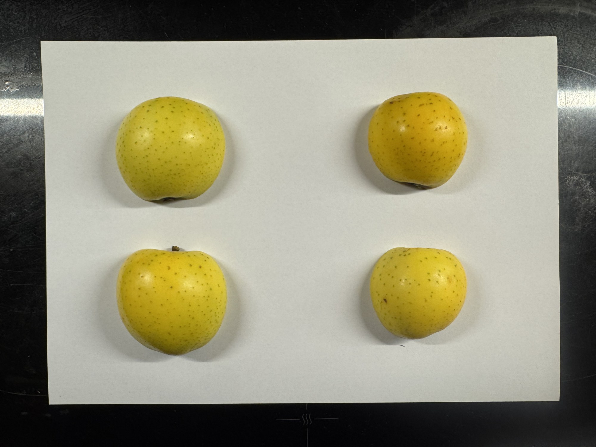
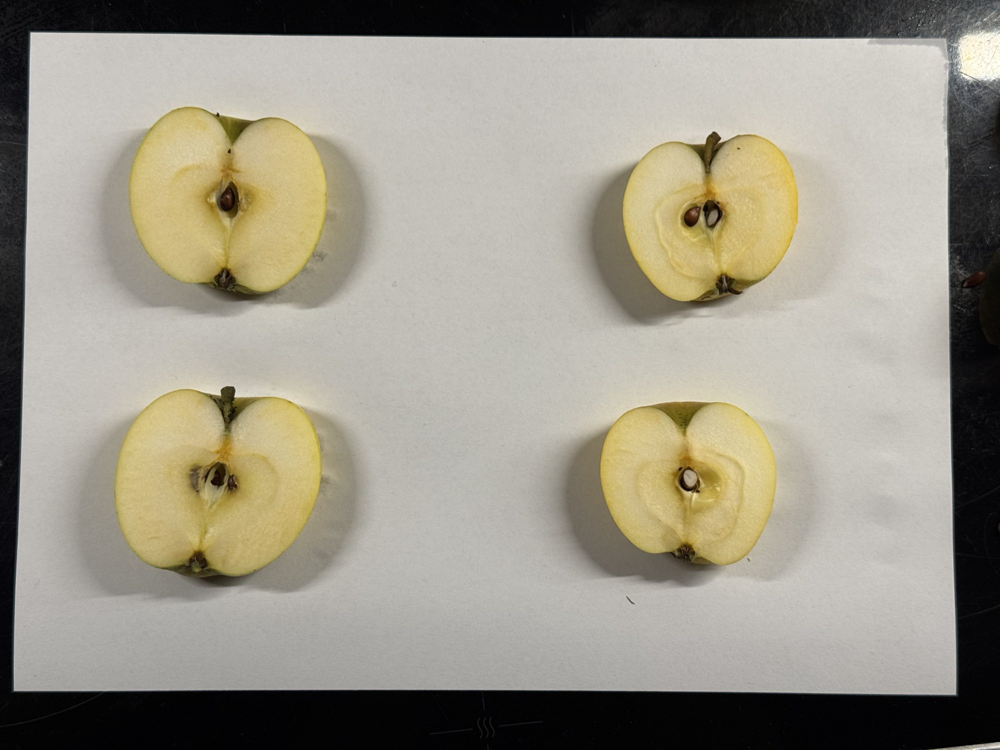
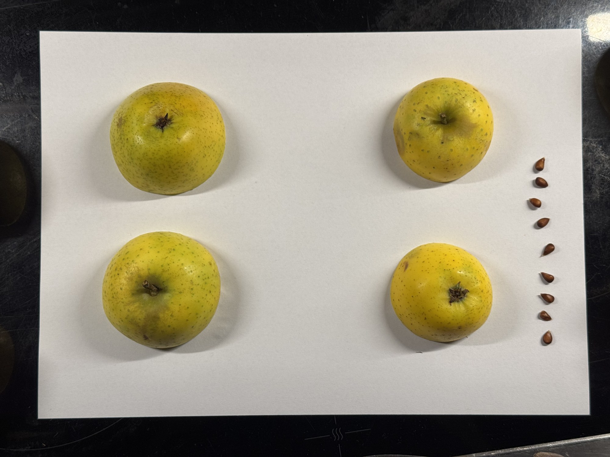
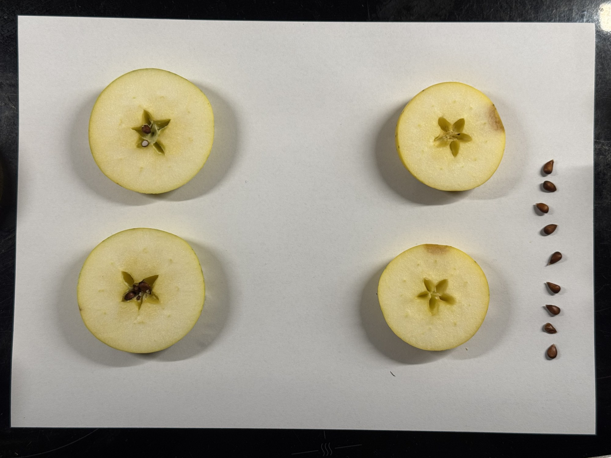

# Fotoanleitung: Apfelsorte bestimmen mit vier Äpfeln und vier Fotos

Stand: 22.10.2026. Erprobt mit Testaufnahmen auf einem iPhone 15 Pro.

## Worum es geht

Pro Baum werden **vier typische Äpfel** jeweils **einmal** geschnitten und auf einem weißen A4-Blatt fotografiert. Vier Fotos zeigen alle Ansichten, die Pomologen zur Bestimmung nutzen, und zwar von verschiedenen Äpfeln, damit die Bandbreite eines Baums sichtbar wird. Danach kann man alles essen.

Das A4-Blatt (210 × 297 mm) dient als Maßstab und für den Weißabgleich. Etwas auszudrucken ist nicht nötig. Baum, Datum und Standort erfasst die App.

## Was du brauchst

- 4 typische Äpfel vom selben Baum: keine besonders kleinen, deformierten oder beschädigten
- 1 frisches, weißes A4-Blatt pro Baum
- ein scharfes Messer und ein Schneidebrett (nicht auf dem Blatt schneiden)
- gutes, gleichmäßiges Licht: Tageslicht am Fenster oder eine helle Arbeitsleuchte, **kein Blitz**

## Kamera

- **2x-Zoom** verwenden und so weit zurückgehen, dass das A4-Blatt das Bild fast füllt. Bei 1x schaltet das iPhone aus der Nähe auf das Ultraweitwinkel-Objektiv mit Digitalzoom um, die Bilder werden deutlich weicher.
- Senkrecht von oben fotografieren, das **ganze Blatt mit allen vier Ecken** im Bild.
- Blitz aus. Er verdeckt den Kelch und die feinen Details der Schale.
- Das Handy ruhig halten; im Zweifel zwei Fotos machen.

## Legen

- Die Teile im **2 × 2-Raster** auf das Blatt legen, mit etwas Abstand zueinander und zum Rand.
- Die Kerne eines Apfels in einer Reihe am Rand des Blatts auslegen.
- Die Teile nicht übereinanderlegen und nicht anfassen lassen.

## Die vier Fotos

### Äpfel A und B: Längsschnitt

Beide Äpfel **längs genau durch Stiel und Kelch** halbieren.

**Foto 1: Längshälften, Schale nach oben**
Alle vier Hälften mit der Schnittfläche nach unten legen. Bei Apfel A die stärker gefärbte Seite nach oben, bei Apfel B die blassere.
*Zeigt:* Umriss in exakter Größe (Höhe, Breite, Form, Symmetrie), Grundfarbe, Deckfarbe und ihr Muster, Berostung, Lentizellen.

**Foto 2: Längsscheiben, Kernhaus nach oben**
Von jeder Hälfte die runde Kappe parallel zur Schnittfläche abschneiden, sodass eine etwa 1 cm dicke Scheibe bleibt. Die Scheibe mit der **mittigen Schnittfläche nach oben** legen (die Seite mit dem Kernhaus).
*Zeigt:* Kernhausform und -größe, Kelchhöhle mit Kelchröhre, Tiefe und Form von Stiel- und Kelchgrube, Stiel, Fleischfarbe.
Danach die **Kerne von Apfel A** vollständig herauslösen, auch aus den Kappen. Sie kommen auf Foto 3 und 4.

### Äpfel C und D: Querschnitt

Beide Äpfel **quer an der breitesten Stelle** durch die Mitte des Kernhauses halbieren.

**Foto 3: Querhälften, Schale nach oben, mit Kernen**
Alle vier Hälften mit der Schnittfläche nach unten legen: zwei zeigen den Kelch, zwei die Stielgrube. Die Kerne von Apfel A am Rand in eine Reihe legen.
*Zeigt:* Kelch (Kelchblätter, offen oder geschlossen), Kelchgrube, Kronung, Rippung, Stiel, Stielgrube, Berostung am Stiel, Durchmesser in exakter Größe, Anzahl, Größe und Form der Kerne.

**Foto 4: Querscheiben, Kernhausstern nach oben**
Von jeder Hälfte die runde Kappe abschneiden, sodass eine etwa 1 cm dicke Scheibe bleibt. Mit der **mittigen Schnittfläche nach oben** legen. Die Kerne bleiben am Rand liegen.
*Zeigt:* Kernhausstern, Öffnung und Form der Kernfächer, Gefäßbündel, Fleischfarbe.

## Mehrere Bäume

- Für jeden Baum ein frisches Blatt (Saftflecken stören die Erkennung).
- Die Fotos eines Baums direkt nacheinander machen und in der App dem Baum zuordnen.
- **Besser bestimmbar mit einem zweiten Satz** (vier weitere Äpfel, nochmal vier Fotos), wenn genug Früchte da sind. Die Abstimmung über mehrere Früchte verbessert die Erkennung deutlich.

## Was die Fotos nicht zeigen

Diese Angaben fragt die App ab oder sie kommen aus anderen Aufnahmen:

- Geschmack, Saftigkeit, Festigkeit
- Pflückreife und Genussreife
- Baum (Wuchs), Blüte und Blütezeit
- Gewicht (optional mit Küchenwaage)

Sehr feine Details wie der Ansatz der Staubfäden in der Kelchhöhle sind auf A4-Fotos nicht sicher erkennbar. Nahaufnahmen sind optional und nur nötig, wenn die App unsicher ist.

## Bekannte Grenzen

- **Kein Farbabgleich**, nur Weißabgleich am Papier. Farben sind deshalb zwischen verschiedenen Handys und Lichtquellen nur eingeschränkt vergleichbar.
- **Größe:** Schalenhälften (Foto 1 und 3) liegen mit ihrem breitesten Umriss auf Papierhöhe und sind exakt messbar. Die Scheiben (Foto 2 und 4) liegen etwa 1 cm über dem Papier, der Fehler liegt bei rund 2 % und lässt sich herausrechnen.
- **Einseitiges Licht** wirft Schatten zur selben Seite. Das stört die Erkennung kaum, solange es gleichmäßig ist.
